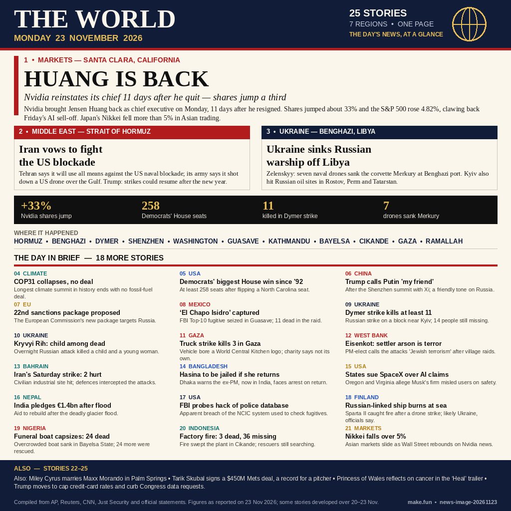

# World News — Monday 23 November 2026

[](https://make.fun/bounty/news-image-20261123?utm_source=github&utm_medium=readme&utm_campaign=news-image-20261123)
[](https://make.fun/bounty/news-image-20261123/leaderboard?utm_source=github&utm_medium=readme&utm_campaign=news-image-20261123)
[](https://make.fun/bounty/news-image-20261123?utm_source=github&utm_medium=readme&utm_campaign=news-image-20261123)

Entry for make.fun **news-image-20261123**: “Sum up 23 November's world news in one image”.



One newspaper front page, 1024×1024 PNG, 174,349 bytes, 25 stories in 7 regions — same dense front-page layout as the 22 Nov entry (3 hero stories, a numbers strip, a places strip, 18 briefs in 3 columns):

- **Lead — Huang is back:** Nvidia reinstated Jensen Huang as chief executive 11 days after he resigned; shares jumped about 33% and the S&P 500 rose 4.82%, clawing back Friday's AI sell-off.
- **Hero 2 — Iran vows to fight the US blockade:** Tehran says it will use all means against the US naval blockade; its army says it shot down a US drone over the Gulf; Trump says strikes could resume after the new year.
- **Hero 3 — Ukraine sinks a Russian warship off Libya:** seven naval drones sank the corvette Merkury at Benghazi port, Zelenskyy said.
- **USA:** Democrats won at least 258 House seats — their largest majority since 1992; Oregon and Virginia sued SpaceX over AI safety claims; the FBI is probing an apparent hack of the NCIC police database.
- **Ukraine / Europe:** a Russian strike on Dymer killed at least 11, with 14 missing; a child was killed in Kryvyi Rih; the EU proposed a 22nd sanctions package; a Russian-linked ship burned in the Gulf of Finland.
- **Middle East:** Iran's Saturday strike on Bahrain hurt 2; a Gaza truck strike killed 3; Israel's PM-elect called settler arson "Jewish terrorism".
- **Asia:** Trump called Putin "my friend" after the Shenzhen summit with Xi; India pledged €1.4bn to Nepal after the glacier flood; Bangladesh says it will jail ex-PM Hasina if she returns.
- **Mexico:** FBI Top-10 fugitive “El Chapo Isidro” captured in Sinaloa.
- **Climate:** COP31 collapsed with no fossil-fuel deal — the longest climate summit in history.
- **Indonesia:** factory fire in Cikande — 3 dead, 36 missing.
- **Africa:** funeral boat capsizes in Bayelsa, Nigeria — 24 dead.

Sources are listed in [SOURCES.md](SOURCES.md). Figures are those reported on Monday 23 November 2026; a few stories developed over 20–23 November and dominated Monday's coverage.

## Run

```sh
python3 main.py
# writes /output/entry.png
```

`main.py` only copies `entry.png` to `/output/entry.png` — no network, no randomness, deterministic. The page itself was rendered with Pillow from the text in `build_image.py` (kept in the workspace, not part of the entry); the PNG in this repo is the entry.

## Licence

MIT — see [LICENSE](LICENSE).
